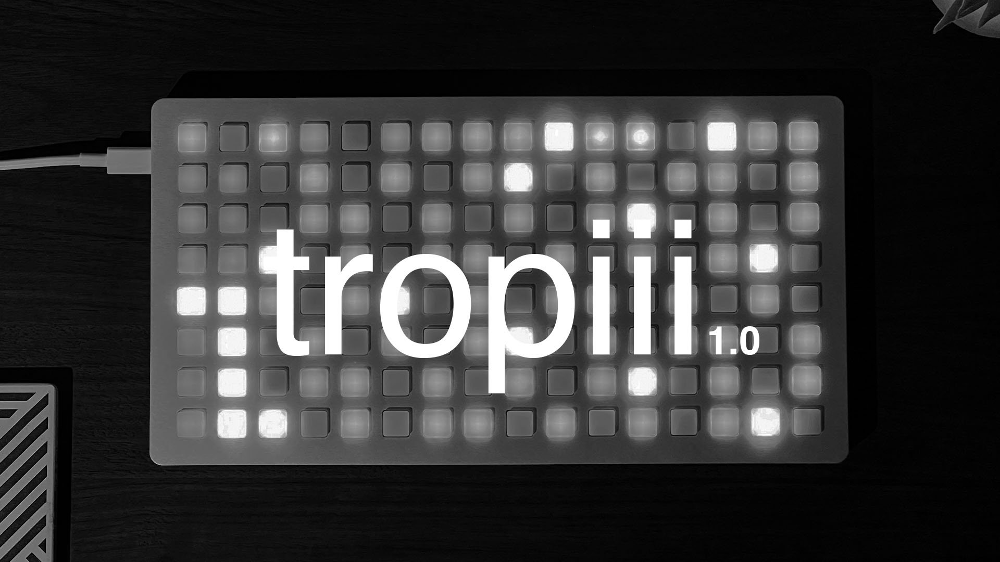
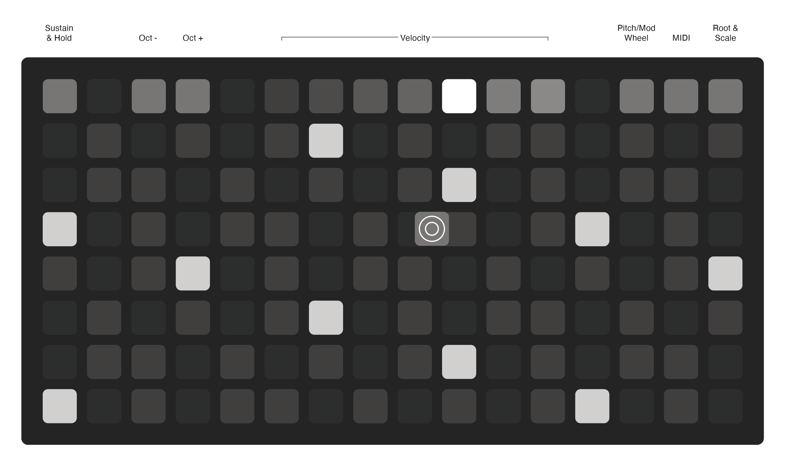
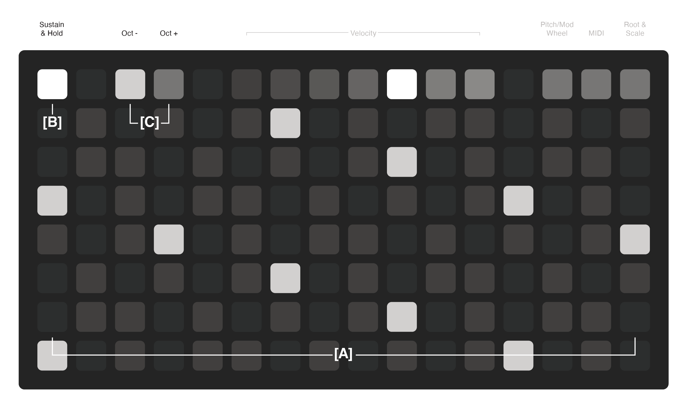
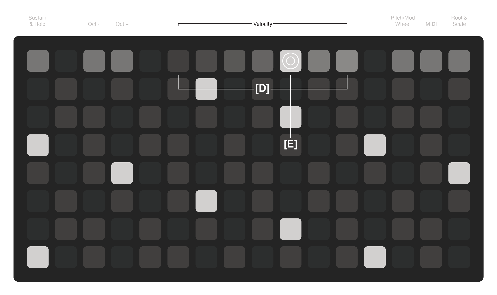
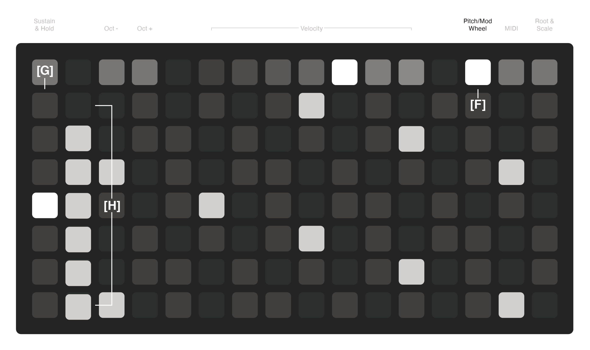
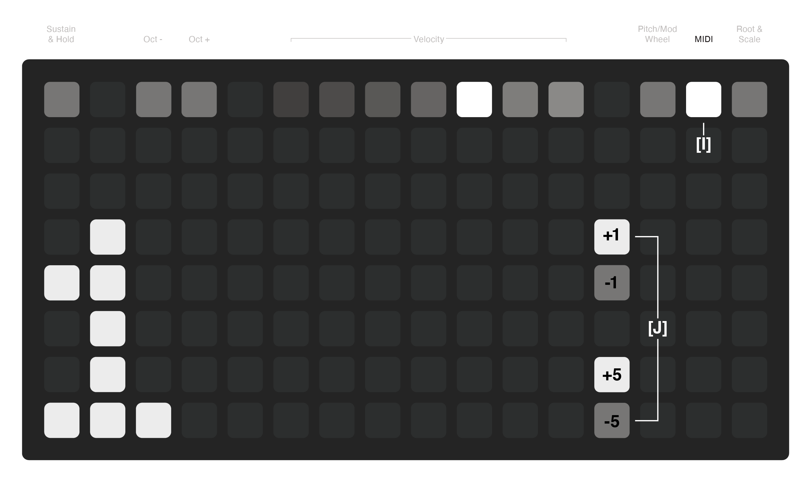
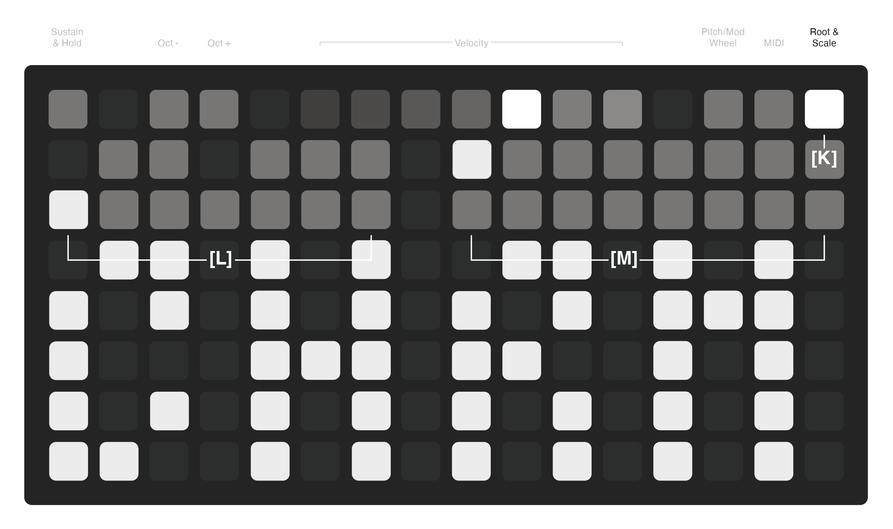

# tropiii
An isometric keyboard for Monome Grid using iii

Current Version 1.0.0

## Overview
Tropiii is an isometric keyboard with adjustable scales and modes that functions as a surface to perform with during live playing. The name tropiii is derived from the Ancient Greek word trópos referring to a specific musical scale or mode.

Tropiii was designed to have all the needed items for play on the main interface, while having a simple, but clear system to change scales or modes and set the MIDI channel.

On the main view, there is a sustain button and seven levels of velocity output easily within reach.

By default, tropiii shows all the chromatic scale notes starting at C3 on the bottom left note, giving almost three octaves of range. The notes take up the entirety of the bottom seven rows of the grid.

## Keyboard - Sustain & Octave
**[A] Keyboard**  
The lower seven rows of the grid serve as the keyboard playing surface. The keys are lit according to the selected scale with the natural notes dimly lit and the sharps not lit. The brightly lit keys show instances of the root note. The keyboard starts on the bottom left with the lowest root note and is built across to the right and up.

**[B] Sustain / Hold**  
The sustain button can be held down temporarily to sustain notes. It sends a value of 127 for CC64 when pressed. A quick double tap of the button will keep the sustain on and will function as a hold.

**[C] Octave Shift**  
These buttons shift the keyboard up or down by one octave. The keyboard can be shifted up to 3 octaves in either direction to extend past a typical 88 key piano.

_Shortcut:_  
Pressing both **[C]** octave buttons simultaneously will return the keyboard to the default position with C3 (or chosen root note) in the bottom left corner.

## Keyboard - Velocity
**[D] Velocity**  
The seven buttons for velocity select the MIDI velocity the notes output when played. The brightly lit button is the current velocity. The velocity values for each button are:  
18, 36, 54, 72, 91, 109, 127.

**[E] Humanize**  
By pressing a velocity button a second time, the script will humanize the velocity. The button will begin to slowly pulse to indicate it is in humanize mode. When in this mode, the value output will be randomly fluctuate between +5 and -5 of the original value with the exception of 127 being the max value possible. Press the button again to disable humanize and return to the static velocity value.

## Pitch & Mod Wheel
**[F] Control Toggle**  
This button toggles the pitch and modulation wheel for the keyboard. When it is lit, the first two columns of the keyboard area become a pitch and mod wheel control. The isometric keyboard shifts to take up the remaining space.

**[G] Pitch Wheel**  
This column of buttons serves as a spring-loaded pitch wheel. The top three buttons above and below the center bend the pitch by fixed increments of ±1 semitone, ±2 semitones, and ±12 semitones.

**[H] Mod Wheel**  
This column of buttons serves as a mod wheel that sends out changes on CC1. The buttons can either be pressed to instantly jump to a value, or they can be held to slowly and smoothly change from one value to the next. The value selected stays until it is changed and remains even if the pitch and mod wheel are hidden.

## MIDI Channel
**[I] MIDI Out Channel**  
This button toggles the MIDI page and shows the channel for MIDI Output. By default, it is set to 1.

**[J] Increments**  
The two sets of buttons next to the number display are for increasing or decreasing the MIDI channel.

MIDI channels can range from OFF, ALL, or 1–16.

## Root & Scale
**[K] Root & Scale**  
This button toggles the root and scale page to change the current settings of the isometric keyboard.

**[L] Root Note**  
These buttons select the root note of the scale. They are laid out like a small piano keyboard. The keys will be lit or off depending on if they are part of the selected scale with the root note lit brightly.

**[M] Scale**  
These buttons select the scale or mode that make up the notes on the isometric keyboard. They work together with the root note to determine the available notes. The text display shows an abbreviation of each scale:

| Display | Scale/Mode | 
| :--- | :--- | 
| CHRM | Chromatic |
| ION | Ionian | 
| AEOL | Aeolian | 
| DOR | Dorian |
| PHRY | Phrygian |
| LYD | Lydian |
| MIXO | Mixolydian |
| LOCR | Locrian |
| HMIN | Harmonic Minor |
| MMIN | Melodic Minor |
| MAJP | Major Pentatonic |
| MINP | Minor Pentatonic |
| BLUE | Minor Blues |
| WHOL | Whole Tone |
| DIM | Diminished |
| AUG | Augmented |

